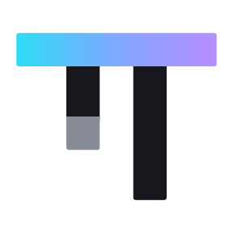
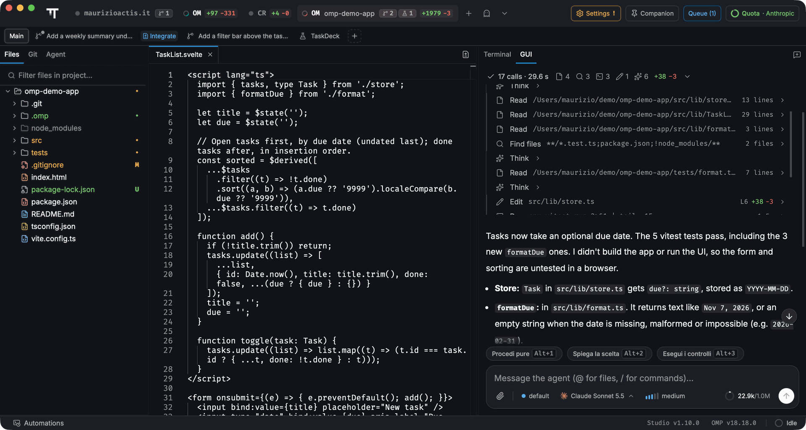
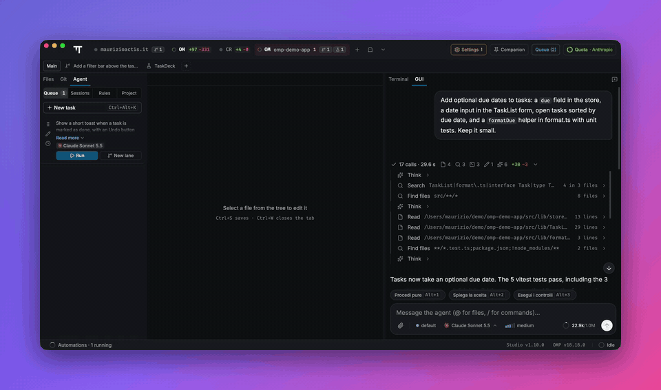
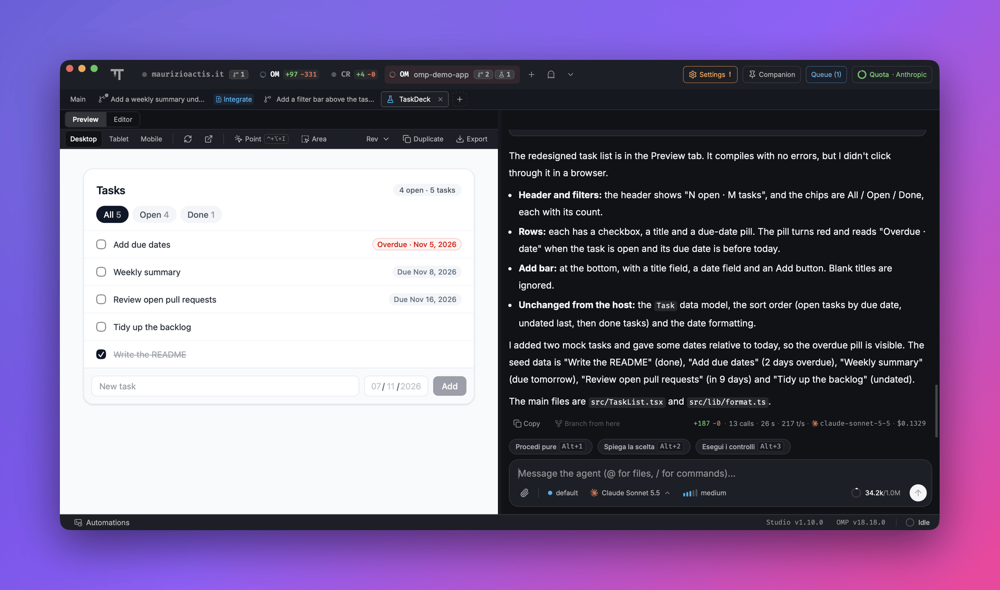
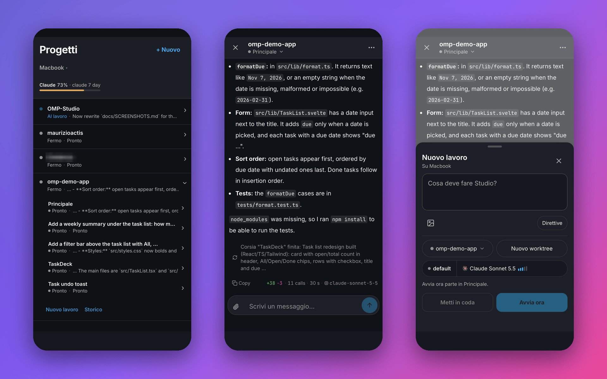

<div align="center">

<picture>
  <source media="(prefers-color-scheme: dark)" srcset="assets/logo/readme-pi-on-dark.png" />
  
</picture>

# OMP Studio

[English](README.md) · **Italiano**

L'ambiente desktop per lavorare con [`omp`](https://github.com/can1357/oh-my-pi) su più progetti,
con più agenti in parallelo in worktree Git isolati: rivedi il loro lavoro e uniscilo con un clic.

[](https://github.com/Bodyes26/OMP-Studio/releases/latest)
[](https://github.com/Bodyes26/OMP-Studio/releases/latest)
[](LICENSE)



</div>

## Cosa puoi fare

- **Tieni aperti tutti i progetti.** Una tessera per repository nella barra in alto; il passaggio è istantaneo e l'agente di ogni progetto continua a lavorare in background. Le tessere mostrano chi lavora, chi aspetta te e quanti task sono in coda.
- **Fai lavorare più agenti in parallelo.** Ogni corsia è un worktree Git su un proprio branch, con la sua conversazione, mentre la Principale resta libera.
- **Rivedi prima di unire.** «Revisione e integrazione» mostra la diff rispetto al branch di destinazione e i comandi eseguiti dall'agente, poi porta tutto in un solo commit squash.
- **Chat o terminale, stessa sessione.** Una chat grafica con schede degli strumenti, diff, piani e domande, oppure il vero terminale di `omp`: `Ctrl+Alt+A` passa dall'uno all'altro senza riavviare niente.
- **Prototipa interfacce nel Laboratorio.** Prototipi React + Tailwind con anteprima dal vivo, varianti e revisioni, consegnati all'agente principale quando sono giusti.
- **Segui dal telefono.** Studio Remote mostra macchine, progetti, corsie e quote, e ti fa rispondere all'agente o avviare lavori da qualunque posto.
- **Metti in coda e pianifica.** Code di task per progetto, task che partono al reset della quota e automazioni attivate da orari, eventi Git o modifiche ai file.
- **Sai quanto stai spendendo.** Quote in tempo reale per ogni provider, statistiche di costi e token, ruoli dei modelli con fallback.

## Come funzionano le corsie

1. Studio apre una corsia: un worktree affiancato su un branch `omp/lane-*`. Se la Principale è occupata, un task in coda può partire da solo in una nuova corsia.
2. L'agente della corsia lavora lì con la sua conversazione; file, Git, editor e chat seguono la corsia selezionata.
3. Quando ha finito lascia un riepilogo. Rivedi la diff, poi la integri nel branch di destinazione, la rimandi alla corsia per altro lavoro o la rifiuti.



## Laboratorio

Il Laboratorio è uno spazio per prototipi di interfaccia accanto al progetto. L'agente prima esplora il progetto e scrive un breve brief da approvare, poi costruisce prototipi React 19 + Tailwind v4 con anteprima dal vivo: una versione fedele, varianti divergenti o un flusso. Con **Indica e disegna** clicchi o disegni sull'anteprima per dire cosa cambiare; ogni richiesta è una revisione a cui puoi tornare. Il prototipo approvato passa all'agente principale, che lo implementa nello stack vero del progetto.



## Studio Remote e Companion

- **Studio Remote** (spento di default) collega Studio a un relay che ospiti tu. Dal telefono o da qualunque browser vedi tutte le macchine, leggi e scrivi nella chat di ogni corsia, rispondi alle domande dell'agente, alleghi file, avvii i task in coda e controlli le quote. Non esiste un relay condiviso: vedi [`relay/`](relay/README.it.md).
- **Companion** è una piccola finestra sempre a portata (`Alt+Space`): raccoglie risposte e domande dell'agente da tutti i progetti, così rispondi o mandi un nuovo task senza riportare Studio in primo piano.



## Download

| Piattaforma | Pacchetto |
|---|---|
| Windows 10/11 x64 | installer `.exe`, per utente, senza diritti di amministratore |
| macOS (Apple Silicon e Intel) | `.dmg` universale |
| Linux x64 | `.deb` o `.AppImage` |

Scarica da [Releases](https://github.com/Bodyes26/OMP-Studio/releases/latest). Studio si aggiorna da solo; nelle Impostazioni scegli tra il canale stabile e Nightly.
Se `omp` non è installato, al primo avvio Studio propone di installarlo e configurarlo.

## Privacy

Studio è un'app locale. Legge i database delle sessioni di `omp` in sola lettura e non invia telemetria. Codice e conversazioni vanno solo ai provider AI che configuri in `omp` e, se attivi Studio Remote, al tuo relay.

## Documentazione

- [Scorciatoie da tastiera](docs/SHORTCUTS.md)
- [Changelog](CHANGELOG.md)
- Note di prodotto, architettura e design: [PRODUCT](docs/PRODUCT.md), [ARCHITECTURE](docs/ARCHITECTURE.md), [DESIGN](docs/DESIGN.md), [DECISIONS](docs/DECISIONS.md)

## Compilare dai sorgenti

Servono Node.js 22.17+, [Bun](https://bun.sh/), Rust stable e gli strumenti di build della piattaforma (Visual Studio C++ su Windows, Xcode Command Line Tools su macOS).

```bash
git clone https://github.com/Bodyes26/OMP-Studio.git
cd OMP-Studio
npm install
npm run tauri -- dev    # avvia l'app
npm run check && npm test
```

## Licenza

[MIT](LICENSE). OMP Studio è sviluppato con `omp` stesso ed è pubblicato come progetto personale: le pull request vengono chiuse automaticamente, i fork sono benvenuti.
