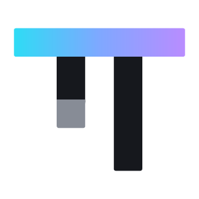
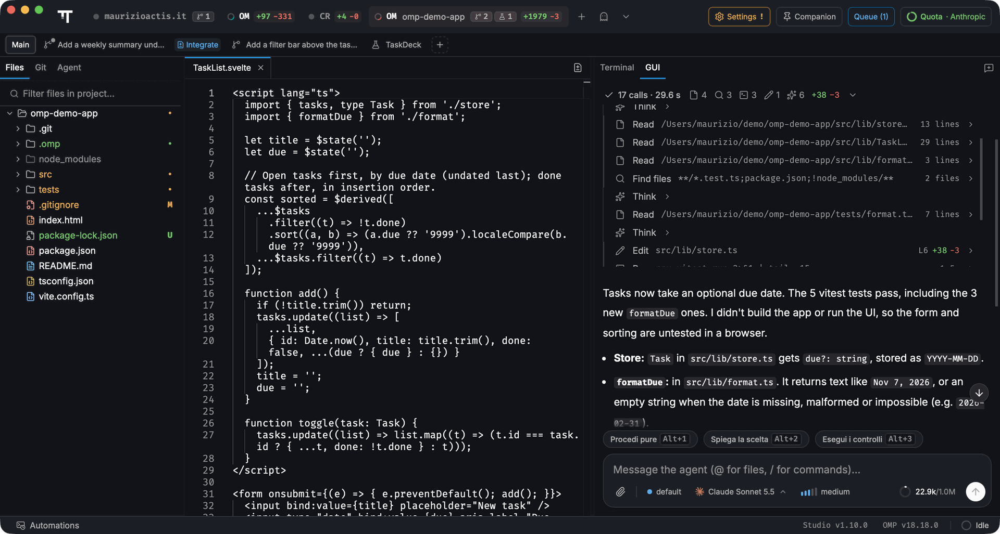
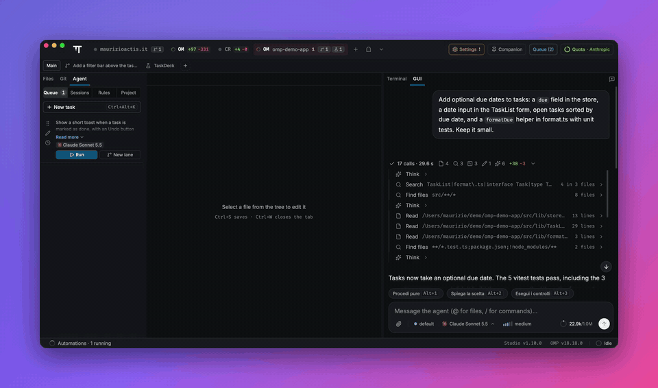
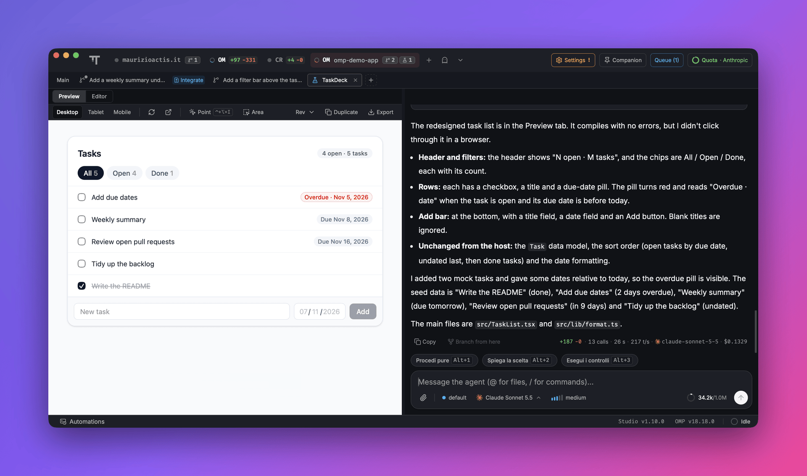
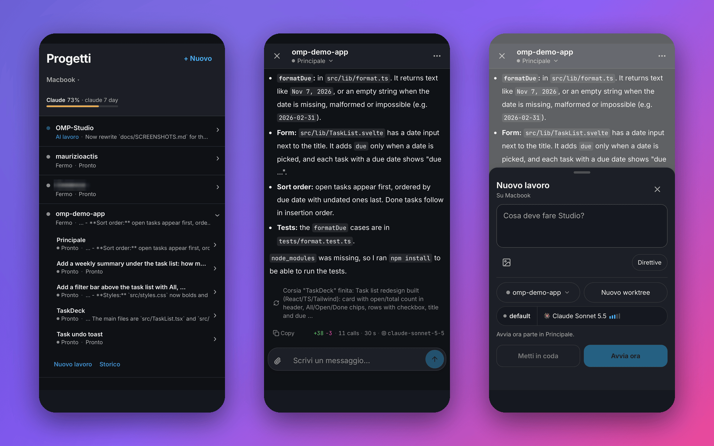

<div align="center">

<picture>
  <source media="(prefers-color-scheme: dark)" srcset="assets/logo/readme-pi-on-dark.png" />
  
</picture>

# OMP Studio

**English** · [Italiano](README.it.md)

The desktop environment for working with [`omp`](https://github.com/can1357/oh-my-pi) across many projects,
with several agents running in parallel in isolated Git worktrees: review their work and merge it with one click.

[](https://github.com/Bodyes26/OMP-Studio/releases/latest)
[](https://github.com/Bodyes26/OMP-Studio/releases/latest)
[](LICENSE)



</div>

## What you can do

- **Keep every project open.** One tile per repository in the top bar; switching is instant and each project's agent keeps working in the background. Tiles show who is working, who is waiting for you and how many tasks are queued.
- **Run agents in parallel.** Each lane is a Git worktree on its own branch with its own conversation, while Main stays free.
- **Review before merging.** "Review & Integrate" shows the diff against the target branch and the commands the agent ran, then lands everything as one squash commit.
- **Chat or terminal, same session.** A graphical chat with tool cards, diffs, plans and questions, or the real `omp` terminal: `Ctrl+Alt+A` switches between them without restarting anything.
- **Prototype interfaces in the Lab.** React + Tailwind prototypes with live preview, variants and revisions, handed over to the main agent when they are right.
- **Follow from your phone.** Studio Remote shows machines, projects, lanes and quotas, and lets you answer the agent or start work from anywhere.
- **Queue and schedule work.** Per-project task queues, tasks that start when the quota resets, and automations triggered by time, Git events or file changes.
- **Know what you are spending.** Live quotas for every provider, cost and token statistics, model roles with fallbacks.

## How lanes work

1. Studio opens a lane: a sibling worktree on an `omp/lane-*` branch. A queued task can start in a new lane by itself when Main is busy.
2. The lane's agent works there with its own conversation; files, Git, editor and chat follow the lane you select.
3. When it is done it leaves a summary. You review the diff, then integrate it into the target branch, return it to the lane for more work, or reject it.



## Lab

The Lab is a workspace for UI prototypes beside the project. The agent first explores the project and writes a short brief for your approval, then builds React 19 + Tailwind v4 prototypes with a live preview: one faithful version, divergent variants, or a flow. With **Point and draw** you click or sketch on the preview to say what to change; every request is a revision you can go back to. The approved prototype is handed over to the main agent, which implements it in the project's real stack.



## Studio Remote and Companion

- **Studio Remote** (off by default) pairs Studio with a relay you host yourself. From your phone or any browser you see every machine, read and write in each lane's chat, answer the agent's questions, attach files, start queued tasks and watch quotas. Setup is separate from Studio: see [Set up Studio Remote](#set-up-studio-remote-optional).
- **Companion** is a small always-available window (`Alt+Space`): it collects the agent's answers and questions from every project, so you can reply or send a new task without bringing Studio to the front.



## Install OMP Studio

This is all you need to use Studio on your computer.

| Platform | Package |
|---|---|
| Windows 10/11 x64 | `.exe` installer, per user, no admin rights |
| macOS (Apple Silicon and Intel) | universal `.dmg` |
| Linux x64 | `.deb` or `.AppImage` |

Download from [Releases](https://github.com/Bodyes26/OMP-Studio/releases/latest). Studio updates itself; in Settings you choose between the stable channel and Nightly.
If `omp` is not installed, the first launch offers to install and configure it.

## Set up Studio Remote (optional)

Studio Remote is not part of the installer. It needs a **relay**: a small server you run yourself, which your Studio machines and your phone both connect to. Studio never opens a port on your computer, and there is no shared or default relay.

| | OMP Studio | Studio Remote relay |
|---|---|---|
| Where it runs | your computer | a server reachable from the internet |
| How you install it | installer from Releases | Docker Compose (`ghcr.io/bodyes26/omp-studio-relay`) |
| What you need | nothing else | Docker, a DNS name, a reverse proxy with TLS and WebSockets |
| Needed for | everything | only phone/browser access |

1. **Start the relay.** On the server, copy [`relay/compose.example.yml`](relay/compose.example.yml) as `compose.yaml` and [`relay/.env.example`](relay/.env.example) as `.env`. In `.env` set `RELAY_ADMIN_TOKEN` (for example `openssl rand -hex 32`, keep it private) and `PROXY_NETWORK` (your reverse proxy's Docker network), then run `docker compose up -d`.
2. **Expose it.** In your reverse proxy route your DNS name to `http://studio-relay:8787` with TLS and WebSockets. `https://<your-relay>/healthz` should answer with the relay version.
3. **Pair your phone.** Open `https://<your-relay>` on the phone, name the device, choose *Use admin secret* and paste `RELAY_ADMIN_TOKEN`. On iPhone, *Share → Add to Home Screen* installs it as an app.
4. **Pair Studio.** In the phone dashboard, *Settings → Pair a machine* shows a code. In Studio open *Settings → Remote Control*, enter the relay address, a machine name and the code, then *Pair*.

Full guide, proxy examples (Nginx Proxy Manager, Caddy), notifications and security notes: [`relay/README.md`](relay/README.md).

## Privacy

Studio is a local app. It reads the `omp` session databases in read-only mode and sends no telemetry. Code and conversations travel only to the AI providers you configure in `omp`, and to your own relay if you turn on Studio Remote.

## Documentation

- [Keyboard shortcuts](docs/SHORTCUTS.en.md)
- [Changelog](CHANGELOG.en.md)
- Product, architecture and design notes (in Italian): [PRODUCT](docs/PRODUCT.md), [ARCHITECTURE](docs/ARCHITECTURE.md), [DESIGN](docs/DESIGN.md), [DECISIONS](docs/DECISIONS.md)

## Building from source

Requires Node.js 22.17+, [Bun](https://bun.sh/), stable Rust and the platform build tools (Visual Studio C++ on Windows, Xcode Command Line Tools on macOS).

```bash
git clone https://github.com/Bodyes26/OMP-Studio.git
cd OMP-Studio
npm install
npm run tauri -- dev    # run the app
npm run check && npm test
```

## License

[MIT](LICENSE). OMP Studio is developed with `omp` itself and published as a personal project: pull requests are closed automatically, forks are welcome.
